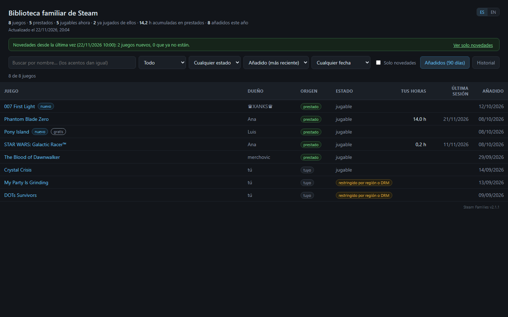

# Steam Families

[](https://github.com/IkerAbad/steam-family-library/actions/workflows/linux.yml)
[](https://github.com/IkerAbad/steam-family-library/actions/workflows/windows.yml)
[](LICENSE)
[](https://github.com/IkerAbad/steam-family-library/actions/workflows/interfaz.yml)
[](https://github.com/IkerAbad/steam-family-library/releases/latest)

Ve qué juegos te presta tu familia en Steam, cuáles son tuyos y qué ha entrado nuevo desde la última vez. Un solo archivo de Python, sin dependencias, con interfaz en el navegador.



Steam fusiona todas las bibliotecas del grupo y no tiene ningún filtro para separarlas. Esto sí.

## Empezar

Sin Python: descarga la [última release](https://github.com/IkerAbad/steam-family-library/releases/latest), descomprime el ZIP y haz doble clic en `iniciar.cmd`.

Si prefieres instalarlo como paquete de Python: `pip install steam-families-library` y después `steam-families`, con las mismas opciones que `iniciar.cmd`. También funciona `pip install .` desde esta carpeta.

1. Instala [Python 3.8 o superior](https://www.python.org/downloads/). En Windows, marca «Add python.exe to PATH».
2. Windows: doble clic en `iniciar.cmd`. Linux o macOS: `./iniciar.sh`. Los datos se guardan en la subcarpeta `datos/`.
3. Se abre una página en `127.0.0.1`. Pega el token la primera vez; a partir de ahí se guarda cifrado y la app se actualiza sola hasta que caduque. Con la ventana abierta repite cada 6 horas (`--cada`).

Solo puede haber una ventana usando la misma carpeta de datos. Si abres otra, avisa y se cierra.

### El token

El token es un JWT que Steam caduca cada 24 horas. La app lo comprueba al arrancar y cada minuto: si ha caducado (o le queda menos de una hora), enseña el motivo y un enlace **Renovar token** a la página oficial, enfoca el campo y no intenta actualizar hasta que pegues uno nuevo. El token caducado no se borra en silencio: queda marcado para que sepas qué pasó.

1. Abre `https://store.steampowered.com/pointssummary/ajaxgetasyncconfig` con la sesión de Steam iniciada.
2. Copia el valor de `webapi_token`. Vale el token suelto o el JSON entero.
3. Pégalo en la interfaz.

En la propia página hay un marcador **Copiar token** que lo deja en el portapapeles de un clic, y un botón **Pegar**.

## Qué genera

| Fichero | Contenido |
|---|---|
| `panel.html` | Panel completo en un solo fichero, sin conexión |
| `library.csv` | Biblioteca entera con la columna `source` (`own` / `family`) |
| `prestados.csv`, `prestados.txt` | Solo lo que te prestan |
| `novedades.txt`, `novedades.json` | Lo que cambió en la última ejecución |
| `historial.csv` | Una fila por novedad y día, sin repetir el mismo evento si actualizas dos veces |
| `snapshot.json` | Retrato de la biblioteca para poder comparar |

Todos se escriben en la subcarpeta `datos/`, que el lanzador pasa con `--datos`.

El panel trae buscador sin acentos, filtros por origen, estado y antigüedad, columna **Añadido** con la fecha de adquisición, marca **nuevo**, marca **gratis** y el atajo **Añadidos (90 días)**. La interfaz y el panel están en español y en inglés: el botón **ES / EN** de la esquina cambia el idioma y la elección se recuerda. `novedades.txt` se escribe en el idioma de la interfaz; `historial.csv` mantiene las columnas en español.

El panel añade vista compacta, exportación de la vista filtrada en CSV o JSON, copia del resumen al portapapeles, un botón **Sorpréndeme** que elige un juego al azar de lo que estás viendo, un top de los más jugados y el intervalo de actualización automática configurable desde la propia página. Pulsar un miembro en las estadísticas filtra la tabla por él. El historial se queda abierto si lo dejas, se exporta en CSV o JSON y las barras de altas por mes filtran ese mes al pulsarlas. Los filtros se reflejan en la dirección y **Copiar enlace** guarda la vista exacta. Cada juego admite una **nota** propia, que se busca como el resto del texto y se filtra con `nota:si` o `nota:no`. El botón **Imprimir** deja una hoja limpia y el panel se recarga solo cuando la app termina una actualización. Los nombres de los miembros se pueden cambiar solo en tu copia (útil cuando Steam los deja como «Miembro 1»), hay una sección **Ya no están** con las bajas de la última actualización, la tabla se adapta a pantallas estrechas y **Copiar nombres** copia la lista de la vista. El buscador combina palabras en cualquier orden, el historial recuerda sus filtros y se ordena por sus cabeceras, que además tienen un botón para limpiarlos, y las estadísticas por miembro se ordenan pulsando las suyas.

La interfaz local incluye **Descargar todo (ZIP)** con los ficheros generados, para hacer una copia o llevártelos a otro equipo.

El buscador admite operadores: `horas:>10`, `horas:1-2`, `anio:2026`, `mes:2026-09`, `fecha:>2026-01-01` / `fecha:2026-01-01..2026-06-30`, `origen:family`, `estado:jugable`, `dueno:ana`, `appid:20`, `ultima:<30` / `ultima:>365` / `ultima:never`, `nota:si` / `nota:no` y `favorito:si` / `oculto:si`, combinables con el texto normal.

Debajo del título, el panel muestra la fecha de la última actualización y la pone en ámbar si tiene más de un día. También avisa si algún miembro sigue como «Miembro N», con enlace a la API key. Recuerda los filtros y el orden, y ordena al pulsar una cabecera.

Los CSV van en UTF-8 con BOM para que Excel respete los acentos.

## Seguridad

- **Ninguna cookie.** No lee, no pide y no guarda cookies de Steam.
- El token se guarda cifrado con DPAPI en `%LOCALAPPDATA%\SteamFamilies\token.bin`. Solo tu usuario de Windows puede descifrarlo y caduca solo en 24 h. Hay un enlace **olvidar**.
- La API key, si la pegas, se guarda igual en `apikey.bin`, en la misma carpeta. **olvidar** borra los dos.
- El token y la API key **no se envían a la página**: el servidor los usa y la interfaz solo sabe si están guardados.
- Nada sale de tu equipo: las únicas conexiones son a `api.steampowered.com` y `steamcommunity.com`.
- El servidor local escucha solo en `127.0.0.1`, comprueba el `Host` y rechaza peticiones de otras webs por `Origin`.
- Los SteamID se guardan como un hash de 10 caracteres, nunca en claro. Los ficheros de datos están en `.gitignore`.

## Terminal

```
python steam_families.py --datos datos              # interfaz en el navegador
python steam_families.py --exportar --token X --datos datos # exporta sin interfaz
python steam_families.py --panel --datos datos      # solo regenera el panel
```

Opciones: `--datos`, `--api-key`, `--include-free`, `--include-non-games`, `--sin-nombres`, `--sin-historial`, `--sin-precios`, `--puerto`, `--cada`, `--sin-navegador`, `--version`. `--cada` acepta horas (0 desactiva) y, si se omite, se usa el valor guardado desde el panel o 6.

## Ejecutable

Si no quieres instalar Python, `python empaquetar.py` genera un ejecutable de un solo fichero en `dist/` con PyInstaller (dependencia de desarrollo). Compílalo en el sistema donde lo vayas a usar. El workflow **Paquete** de GitHub Actions deja los binarios de Windows, Linux, macOS Apple Silicon y macOS Intel como artefactos. Windows puede avisar de que el ejecutable no está firmado; es normal en un binario sin certificado. En macOS el binario no está notarizado: ábrelo con clic derecho → Abrir, o quita la cuarentena con `xattr -d com.apple.quarantine steam-families`.

## Cómo funciona

1. El token es un JWT firmado por Steam; su campo `sub` es tu SteamID64 y `exp` la caducidad.
2. `IFamilyGroupsService/GetFamilyGroupForUser` devuelve el grupo y sus miembros.
3. `IFamilyGroupsService/GetSharedLibraryApps` con `include_own=true` devuelve todas las apps con `owner_steamids`, `exclude_reason` y `rt_playtime`.
4. Si tu SteamID está entre los dueños, el juego es `own`; si no, `family`.
5. Las novedades son la diferencia entre el `snapshot.json` anterior y el actual.
6. Los nombres son el alias público de cada miembro. Se guardan en el snapshot y se refrescan cada 7 días; con API key, en cada ejecución.
7. Los nombres de los juegos se piden en el idioma de la interfaz: español o inglés.

Los tres endpoints de familia están sin documentar: funcionan hoy y pueden cambiar mañana.

## Límites

- El token caduca cada 24 horas. Sin guardar una cookie de sesión no hay forma de renovarlo solo, y guardar cookies queda descartado.
- Los free-to-play cuentan como biblioteca: un juego gratis reclamado también sale como novedad.
- «Comprado», «key» y «regalo» no se distinguen: el endpoint solo dice que alguien lo tiene.
- `rt_time_acquired` se usa como fecha de adquisición porque cuadra con compras reales, pero Valve no documenta su significado exacto.
- Sin API key, los nombres se piden de uno en uno al endpoint público de Steam. Si responde 429, espera 20 s y reintenta, con tres esperas como máximo por ejecución; si sigue frenando, esos miembros quedan como «Miembro 1», «Miembro 2»… hasta la siguiente.
- Los nombres guardados se refrescan a los 7 días para que un cambio de alias no se quede pegado. Con API key se refrescan en cada ejecución.

## Problemas

- **401 al actualizar**: el token ha caducado o se copió cortado. Abre la página del token con la sesión iniciada, usa el marcador **Copiar token** y pulsa **Pegar**. Si sigue, cierra sesión en Steam, entra de nuevo y saca otro.
- **«Miembro 1», «Miembro 2»**: Steam ha frenado las consultas de nombres. Vuelve a actualizar o pega una API key gratuita; los nombres se guardan.
- **«Ya hay otra ventana…»**: otra instancia está usando `datos/`. Ciérrala o pulsa **Detener la interfaz**.
- **No encuentro Python**: instala Python 3.8 o superior con «Add python.exe to PATH»; en Windows también vale `py -3`.
- **No se actualiza sola**: el token caduca a las 24 h; pega uno nuevo.

## Desarrollo

```
python -m unittest discover -s pruebas -v
python -m unittest discover -s pruebas_interfaz -v
python -m unittest discover -s pruebas_plataforma -p "test_windows.py" -v  # Windows
python -m unittest discover -s pruebas_plataforma -p "test_posix.py" -v    # Linux y macOS
```

162 pruebas comunes, 58 de navegador y 4 de plataforma (3 de Windows y 1 de POSIX). Ninguna se salta: la suite común no lleva pruebas de plataforma ni de navegador; la de interfaz se ejecuta en el workflow **Interfaz** con Chromium instalado, y cada workflow de sistema ejecuta su módulo de plataforma. Son las 173 pruebas que ya había, sin borrar ninguna, más las nuevas de errores, empaquetado y renovación del token. Ninguna prueba toca la red real: `pruebas/falso.py` imita la API de Steam y la interfaz levanta un servidor local. La cobertura se publica como `htmlcov` y `coverage.xml`: 93 % de `steam_families.py`, 96 % de `empaquetar.py` y 96 % de `notas_release.py`; el CI falla por debajo del 90 %.

## Créditos

Basado en [salah153/steam-family-library](https://github.com/salah153/steam-family-library). MIT, ver `LICENSE`.

Historial de cambios: [CHANGELOG.md](CHANGELOG.md).

---

# Steam Families (English)

See which games your family lends you on Steam, which ones are yours, and what is new since last time. A single Python file, no dependencies, with a browser interface.

Steam merges all the libraries of the group and has no filter to tell them apart. This does.

## Getting started

Without Python: download the [latest release](https://github.com/IkerAbad/steam-family-library/releases/latest), unzip it and double-click `iniciar.cmd`.

If you prefer to install it as a Python package: `pip install steam-families-library`, then run `steam-families` with the same options as `iniciar.cmd`. `pip install .` from this folder works too.

1. Install [Python 3.8 or higher](https://www.python.org/downloads/). On Windows, tick "Add python.exe to PATH".
2. Windows: double-click `iniciar.cmd`. Linux or macOS: `./iniciar.sh`. Data is stored in the `datos/` subfolder.
3. A page opens on `127.0.0.1`. Paste the token the first time; from then on it is stored encrypted and the app updates itself until it expires. While the window is open it repeats every 6 hours (`--cada`).

Only one window can use the same data folder. If you open another one, it warns and closes.

### The token

The token is a JWT that Steam expires every 24 hours. The app checks it on startup and every minute: if it has expired (or less than an hour is left), it shows the reason and a **Renew token** link to the official page, focuses the field and does not try to update until you paste a new one. The expired token is not silently deleted: it stays flagged so you know what happened.

1. Open `https://store.steampowered.com/pointssummary/ajaxgetasyncconfig` while signed in to Steam.
2. Copy the value of `webapi_token`. Either the bare token or the whole JSON works.
3. Paste it in the interface.

The page itself has a **Copiar token** bookmarklet that puts the token on the clipboard in one click, and a **Pegar** (paste) button.

## What it generates

| File | Content |
|---|---|
| `panel.html` | The full dashboard in a single offline file |
| `library.csv` | The whole library with a `source` column (`own` / `family`) |
| `prestados.csv`, `prestados.txt` | Only what is lent to you |
| `novedades.txt`, `novedades.json` | What changed in the last run |
| `historial.csv` | One row per change and day, without repeating the same event if you update twice |
| `snapshot.json` | A snapshot of the library to compare against |

All of them go into the `datos/` subfolder, which the launcher passes with `--datos`.

The dashboard has accent-insensitive search, filters by origin, status and age, an **Añadido** (added) column with the acquisition date, a **nuevo** (new) tag, a **gratis** (free) tag and the **Añadidos (90 días)** shortcut (added in the last 90 days). The interface and the dashboard come in Spanish and English: the **ES / EN** button in the corner switches the language and the choice is remembered. `novedades.txt` is written in the interface language; `historial.csv` keeps Spanish column names.

The dashboard adds a compact view, export of the filtered view as CSV or JSON, copying the summary to the clipboard, a **Surprise me** button that picks a random game from what you are seeing, a most-played top and the auto-update interval configurable from the page itself. Clicking a member in the stats filters the table by them. The history stays open if you leave it open, exports as CSV or JSON and the monthly bars filter that month when clicked. Filters are reflected in the address and **Copy link** saves the exact view. Each game accepts a **note**, searched like any other text and filtered with `nota:si` or `nota:no`. The **Print** button leaves a clean sheet and the dashboard reloads itself when the app finishes an update. Member names can be changed in your copy only (useful when Steam leaves them as "Miembro 1"), there is a **No longer there** section with the last update's departures, the table adapts to narrow screens and **Copy names** copies the list of the current view. Search combines words in any order, the history remembers its filters and is sorted by its headers, with its own clear-filters button, and the per-member stats are sorted by clicking their headers.

The local interface includes **Download everything (ZIP)** with the generated files, to make a backup or take them to another computer.

The search box accepts operators: `horas:>10`, `horas:1-2`, `anio:2026`, `mes:2026-09`, `fecha:>2026-01-01` / `fecha:2026-01-01..2026-06-30`, `origen:family`, `estado:jugable`, `dueno:ana`, `appid:20`, `ultima:<30` / `ultima:>365` / `ultima:never`, `nota:si` / `nota:no` and `favorito:si` / `oculto:si`, combined with normal text.

Under the title, the dashboard shows the last update time and turns it amber when the data is over a day old. It also warns when a member is still "Miembro N", with a link to the API key. It remembers your filters and sort order, and sorts when you click a column header.

CSVs are UTF-8 with BOM so Excel respects accents.

## Security

- **No cookies.** It does not read, ask for or store Steam cookies.
- The token is stored encrypted with DPAPI in `%LOCALAPPDATA%\SteamFamilies\token.bin`. Only your Windows user can decrypt it, and it expires on its own after 24 h. There is a **olvidar** (forget) link.
- The API key, if you paste one, is stored the same way in `apikey.bin`, in the same folder. **olvidar** deletes both.
- The token and the API key are **never sent to the page**: the server uses them and the interface only knows whether they are stored.
- Nothing leaves your machine: the only connections are to `api.steampowered.com` and `steamcommunity.com`.
- The local server listens only on `127.0.0.1`, checks the `Host` header and rejects requests from other websites by `Origin`.
- SteamIDs are stored as a 10-character hash, never in the clear. The data files are in `.gitignore`.

## Terminal

```
python steam_families.py --datos datos              # browser interface
python steam_families.py --exportar --token X --datos datos # export without the interface
python steam_families.py --panel --datos datos      # only regenerate the dashboard
```

Options: `--datos`, `--api-key`, `--include-free`, `--include-non-games`, `--sin-nombres`, `--sin-historial`, `--sin-precios`, `--puerto`, `--cada`, `--sin-navegador`, `--version`. `--cada` takes hours (0 disables it) and, when omitted, uses the value saved from the dashboard or 6.

## Executable

If you do not want to install Python, `python empaquetar.py` builds a single-file executable in `dist/` with PyInstaller (a development dependency). Build it on the system where you are going to use it. The **Paquete** workflow in GitHub Actions uploads the Windows, Linux, macOS Apple Silicon and macOS Intel artifacts. Windows may warn that the executable is unsigned; that is normal for a binary without a certificate. On macOS the binary is not notarised: open it with right-click → Open, or remove the quarantine with `xattr -d com.apple.quarantine steam-families`.

## How it works

1. The token is a JWT signed by Steam; its `sub` field is your SteamID64 and `exp` the expiry.
2. `IFamilyGroupsService/GetFamilyGroupForUser` returns the group and its members.
3. `IFamilyGroupsService/GetSharedLibraryApps` with `include_own=true` returns all apps with `owner_steamids`, `exclude_reason` and `rt_playtime`.
4. If your SteamID is among the owners, the game is `own`; otherwise `family`.
5. What is new is the difference between the previous `snapshot.json` and the current one.
6. Names are each member's public alias. They are stored in the snapshot and refreshed every 7 days; with an API key, on every run.
7. Game names are requested in the interface language: Spanish or English.

The three family endpoints are undocumented: they work today and may change tomorrow.

## Limits

- The token expires every 24 hours. Without storing a session cookie there is no way to renew it automatically, and storing cookies is ruled out.
- Free-to-play games count as library: a free game that was claimed also shows up as new.
- "Bought", "key" and "gift" cannot be told apart: the endpoint only says that someone has it.
- `rt_time_acquired` is used as the acquisition date because it matches real purchases, but Valve does not document what it exactly means.
- Without an API key, names are requested one by one from Steam's public endpoint. If it answers 429, it waits 20 s and retries, with at most three waits per run; if it keeps throttling, those members stay as "Miembro 1", "Miembro 2"... until the next run.
- Stored names are refreshed after 7 days so an alias change does not stay stuck. With an API key they are refreshed on every run.

## Troubleshooting

- **401 when updating**: the token expired or was copied truncated. Open the token page while signed in, use the **Copiar token** bookmark and press **Pegar** (paste). If it persists, sign out of Steam, sign in again and get a new one.
- **"Miembro 1", "Miembro 2"**: Steam is throttling name lookups. Update again or paste a free API key; names are stored.
- **"Another window..."**: another instance is using `datos/`. Close it or press **Detener la interfaz** (stop).
- **Python not found**: install Python 3.8+ with "Add python.exe to PATH"; on Windows the `py -3` launcher also works.
- **It does not update by itself**: the token expires after 24 h; paste a new one.

## Development

```
python -m unittest discover -s pruebas -v
python -m unittest discover -s pruebas_interfaz -v
python -m unittest discover -s pruebas_plataforma -p "test_windows.py" -v  # Windows
python -m unittest discover -s pruebas_plataforma -p "test_posix.py" -v    # Linux and macOS
```

162 common tests, 58 browser tests and 4 platform tests (3 Windows and 1 POSIX). None is skipped: the common suite has no platform or browser tests, the interface suite runs in the **Interfaz** workflow with Chromium installed, and each OS workflow runs its platform module. These are the 173 tests that already existed, with none removed, plus the new error, packaging and token-renewal tests. No test touches the real network: `pruebas/falso.py` imitates the Steam API and the interface starts a local server. Coverage is published as `htmlcov` and `coverage.xml`: 93 % for `steam_families.py`, 96 % for `empaquetar.py` and 96 % for `notas_release.py`; CI fails below 90 %.

## Credits

Based on [salah153/steam-family-library](https://github.com/salah153/steam-family-library). MIT, see `LICENSE`.

Changelog: [CHANGELOG.md](CHANGELOG.md).
